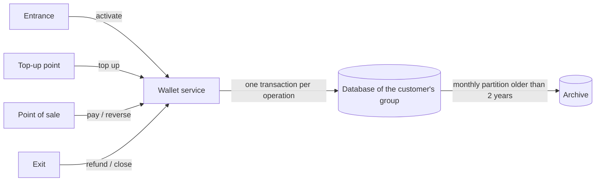
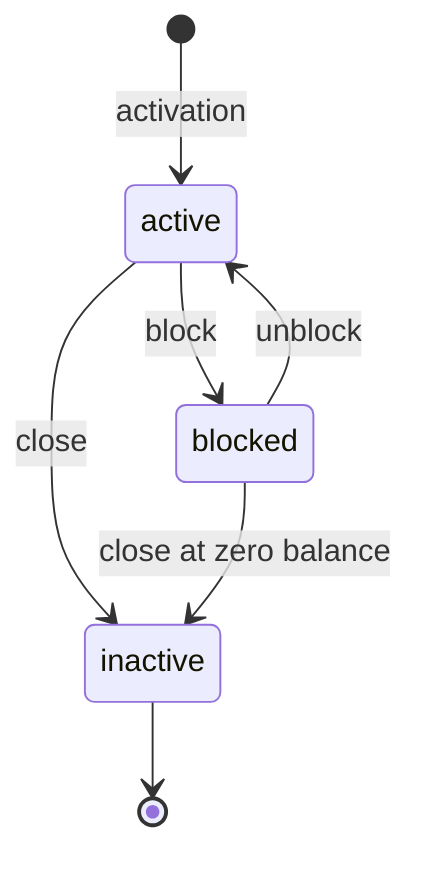
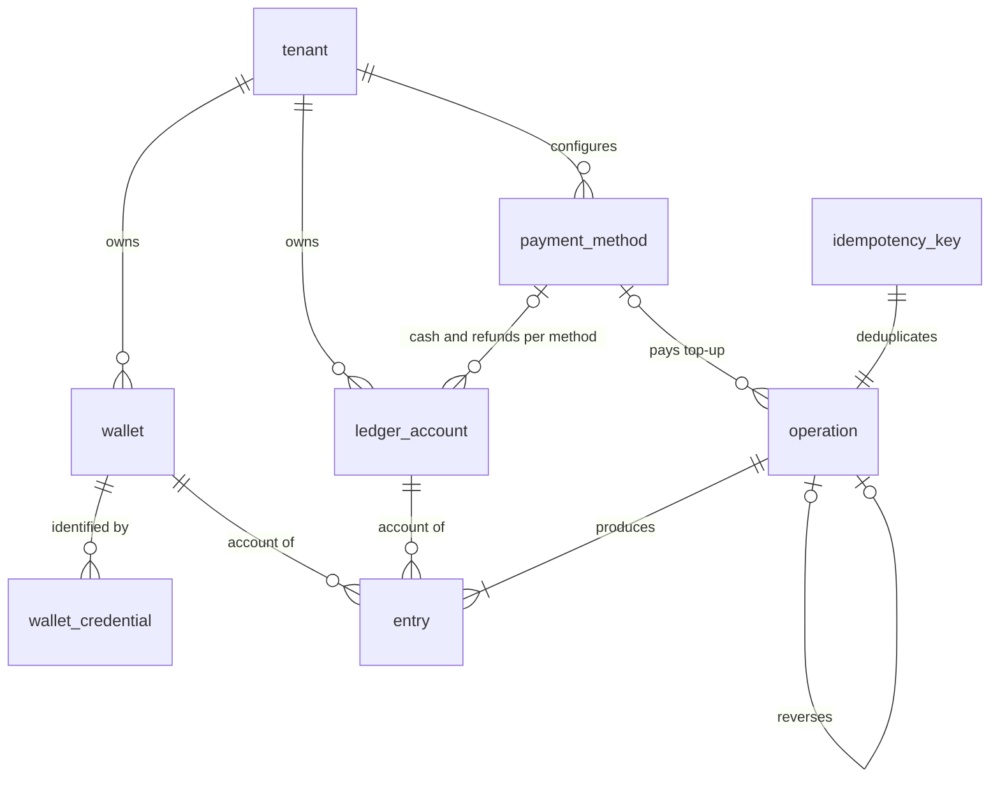

# Wallet core

| | |
|---|---|
| **Status** | confirmed by obogoni (author and owner of this study), 2026-10-05, first recorded in issue #1 |
| **Ready to plan?** | Yes for the model: the load spike (#3) chose PostgreSQL 17 and kept the model, with the archive additions in D7. Closing still waits on how refundable balance works. Every contract waits on the Core API, not yet designed. See Open. |
| **Review** | load spike (#3) results recorded 2026-11-17; next review when the Core API RFC is drafted - obogoni (author) |

**How to read.** From Summary to Open is the design the team aligns on. Slices cuts the work: one section per slice, with its rules, its contract and the data that matters. The spec of each feature starts from its slice and details the rest against the code.

## Summary

A system design study: the core of a SaaS digital wallet for theme parks and clubs, sized from real usage of an on-premise product. It covers activation, top-up, payment, reversal, transfer, balance refund, closing and the statement, served to every customer from one service. It leaves out vouchers, rentals, KYC, anti-fraud, the top-up payment processor and reports.

1. A double-entry ledger: each operation writes immutable entries that sum to zero, across wallets and per-customer counterpart accounts.
2. The balance is stored on the wallet and checked against the credit limit in the same atomic write. Counterpart accounts store no balance, so they never become hot rows.
3. Every operation is exactly-once: an idempotency key per customer for 30 days, and a reversal at most once.
4. Customers are grouped per database and never split; the ledger keeps 2 years online in monthly partitions.

**What is expensive to get wrong:** the ledger shape (D1). Changing it later means migrating every customer's history.

## Context and problem

**Where the project is.** In active construction: a new repository, nothing shipped. It is a learning project framed as a system design interview, so being wrong costs rework within the study and nothing else.

**What this piece makes possible.** The reference product runs on-premise, one database per customer, so it never faced the performance and resilience of a centralised SaaS load. This design is the core the API and the high-level design are built on. Without it, neither can start.

**The journey.** A visitor gets a wallet at the entrance (card, wristband or QR code), tops it up, pays at points of sale and settles the bill on the way out. The wallet is prepaid, or postpaid with a credit limit.

**What this reuses.** The data-model decisions follow the prior-art research in `docs/research/wallet-data-model-prior-art.md` (issue #2). Nothing from the reference product's schema is copied.

### Evidence

24 full months from one of the largest customers of the reference product. The capacity target is 100× that load: about 100 customers, each the size of the largest one.

| Measure | Customer | 100× target | Reading |
|---|---|---|---|
| Movements per day (average) | 17.9k | 1.79 million | Stable: each of the two years has 6.45 million movements |
| Peak day (Sunday, school holidays) | 44.0k | 4.40 million | |
| Peak hour (1 pm, peak days) | 5,685/h | ~158/s | |
| p99 minute | 103/min | ~172/s | 8× the average |
| Organic peak minute | 871/min | ~1,450/s | 71× the average: sizing by the average is off by two orders of magnitude |
| Maximum minute (batch) | 3,207/min | ~5,345/s | |
| Maximum second (batch) | 76/s | ~7,600/s | The largest peaks are batches touching 1 to 5 accounts. Not a target: it assumes every customer's batch lands in the same second, and no business need asks for it |
| Wallets with movements in 24 months | 1.13 million | 113 million | p50 of 6 movements and 1 day of use per wallet |
| Wallets active on the peak day | 17.6k | 1.76 million | |

What the data says about the design:

- **Hot wallets come only from batches.** One wallet reached 70 writes/s in a batch; in normal use a wallet gets under 1 write/s.
- **Wallets are short-lived and postpaid.** About 98% of day-use cards have a credit limit.
- **42% of movements move no money.** They only attach vouchers and rentals, yet every statement has to filter them out.
- **The read rate is not measured.** The reference product does not record balance or statement queries.

## How we will know it worked

| What to watch | Target | How to measure | Measured (#3, 2026-11-17) |
|---|---|---|---|
| Write throughput on one database node | 1,500 operations/s (~3,000 entry rows/s) sustained, p99 ≤ 300 ms on payment | Load generator of the spike (#3) | 1,500/s for 5 min at payment p99 **1.8 ms**. Ceiling ~7,650/s at 12–24 connections, about 5× headroom, on a laptop that also runs the load generator |
| Invariant violations under that load | 0 for every invariant in [Invariants](#invariants) | Invariant checks run by the spike (#3) | **0** after every scenario, including a dropped month |
| The document as an interview script | Walked through in 45 to 60 minutes | Timed dry run by the author | not yet |

**Signs it is going wrong:**

- The spike's write path does not get close to 1,500 operations/s. Then the model or the distribution across databases changes before the API.
- Lock wait on the 70 writes/s batch wallet dominates latency.

## Scope

**In**

- Wallet activation, deactivation, blocking and unblocking
- Top-up, payment, reversal, transfer between wallets of one customer
- Balance refund and closing a postpaid wallet
- Balance and statement
- Credit limit, daily limit, PIN and maximum amount without PIN

**Out**

| Left out | Why / where it lands |
|---|---|
| Vouchers, all-inclusive, item rental | Move no money (D6); get their own structure later |
| Paying one sale with several wallets | The integrator pays once per wallet and reverses the earlier ones if one fails |
| Batch activation | Each wallet is one call; bulk loads are rate-limited per customer |
| Batch bursts (7,600/s at 100×) | Not a business need; batches are rate-limited per customer like bulk loads. Dropped 2026-11-17 |
| Group closing, debt collection, balance expiry, partial reversal, refund fee | Not part of this study |
| KYC, anti-fraud, top-up payment processor, notifications, cash register, tax invoicing, reports | Outside the wallet core |
| API contracts, availability, replicas, failover | Next blocks of the roadmap: Core API RFC and high-level design |

**Business rules decided:**

- A blocked wallet rejects every movement except a balance refund.
- A reversal is always for the full amount.
- Prepaid balance never expires. A postpaid wallet that leaves without closing stays active with a negative balance.
- Every payment is online: no offline sales, so the server balance is always the truth.
- The statement is online for 2 years, then archived and retrieved on demand.

## How it works

### Overview

- Callers are the customer's integrator systems, never the visitor.
- Each operation is one transaction in the database of the customer's group.

The journey, one line each:

1. The visitor gets a wallet at the entrance, bound to a card, wristband or QR code.
2. The visitor tops it up, or uses it on credit if postpaid.
3. The visitor pays at points of sale; a sale can be reversed in full.
4. On the way out, the visitor settles the bill: debt is paid, remaining refundable balance is returned, the wallet closes.

### Lifecycle

Only `active` accepts movements. `blocked` accepts a balance refund only. Closing from `blocked` is a default in [Closing](#closing).

### Data model

| Record | Role | New? | Detail in |
|---|---|---|---|
| `tenant` | A customer (park or club), with time zone and refund rules | new | [Wallet](#wallet) |
| `payment_method` | How a customer accepts top-ups, and whether that money is refundable | new | [Wallet](#wallet) |
| `ledger_account` | Counterpart accounts per customer: `cash` and `refunds_paid` per method, one `revenue`; `archived_total` of archived months | new | [Wallet](#wallet) |
| `wallet` | The visitor's account, with its stored balance and limits | new | [Wallet](#wallet) |
| `wallet_credential` | Card, wristband or QR code bound to a wallet for a period | new | [Wallet](#wallet) |
| `operation` | One business operation and its request | new | [TopUp](#topup) |
| `entry` | One immutable leg of an operation on one account | new | [TopUp](#topup) |
| `idempotency_key` | Request key per customer, kept 30 days | new | [TopUp](#topup) |
| `archive_state` | Where the online window starts (`online_from`), one row per database | new | [Archive](#archive) |

### How each operation posts

A wallet balance is what the wallet owes its holder. Signs are from the wallet's side.

| Operation | Wallet | Counterpart |
|---|---|---|
| Top-up | +x | `cash:<method>` −x |
| Payment | −x | `revenue` +x |
| Balance refund | −x | `refunds_paid:<method>` +x |
| Transfer | source −x, destination +x | none |
| Reversal | mirror of the original | mirror of the original |

A postpaid wallet below zero is the customer's receivable and needs no account of its own.

### Invariants

1. A wallet's balance never goes below `-credit_limit`.
2. A wallet's entries have `seq` 1, 2, 3… with no gap or duplicate, and each `balance_after` equals the previous one plus `amount`.
3. `wallet.archived_balance` (the balance at the last archived entry, D7) plus the sum of the wallet's entries with `seq > archived_seq` equals `wallet.balance`.
4. Each operation's entries sum to zero.
5. Per customer, wallet balances plus counterpart entries since `online_from` plus counterpart `archived_total` sum to zero.
6. An operation is reversed at most once, and an idempotency key maps to one operation.

### Vocabulary

| Term | Means |
|---|---|
| **counterpart account** | A per-customer `ledger_account` on the other side of a wallet entry: `cash`, `revenue` or `refunds_paid` |
| **customer group** | The set of customers that share one database (D8) |

### Heavier alternative

Partition the ledger by wallet across many databases.

- **Why not now:** the largest customer makes ~15 operations/s at peak, far below one database.
- **When it wins:** one customer outgrows a database.
- **What this design does not survive:** a single customer whose load exceeds one database node.

## Key decisions

These are the decisions every slice builds on; slices cite them by code. Not all are hard to reverse: the last column says how costly each is to change.

| | Decision | Slices it affects | To change later |
|---|---|---|---|
| D1 | Double-entry ledger | TopUp, Payment, Reversal, Transfer, Closing | one-way |
| D2 | Balance stored on wallets only | Wallet, TopUp, Payment, Transfer, Closing | costly on wallets, reversible on counterparts |
| D3 | Limit checked in one atomic write | Payment, Reversal, Transfer, Closing | reversible |
| D4 | Exactly once | TopUp, Payment, Reversal, Transfer, Closing | reversible |
| D5 | Gapless wallet sequence | TopUp, Statement | costly |
| D6 | Ledger holds only money | TopUp, Payment, Statement | one-way |
| D7 | Two years online, monthly | Statement, Archive | costly partitioning, reversible archive boundary |
| D8 | One customer, one database | Wallet, Transfer | costly |

### D1 — Double-entry ledger

**Rule.** Each operation is one `operation` and two or more immutable entries that sum to zero, written in one transaction. An entry points at a wallet or a counterpart account; both share one id space. Every entry is born confirmed: there is no pending state.

**Consequence.** The wallet keeps its own record of cash per method and revenue, to reconcile against the point of sale and the ERP. It costs about twice the entry rows.

**Alternative.** Single-sided wallet entries win only if the wallet is never reconciled; performance alone would not decide it, since a customer's `revenue` sees ~15 writes/s at peak. Transfer rows (`debit_account`, `credit_account`, `amount`) fit every operation in scope, which all have two legs. They win only if that stays true and statements are rare. Bonus top-ups, multi-wallet payment and revenue split by tax would add legs.

### D2 — Balance stored on wallets only

**Rule.** `wallet.balance` is updated in the transaction that writes the entries. Counterpart accounts store no balance; their totals come from entries or an off-path rollup.

**Consequence.** The balance survives archiving, since history is online for 2 years and the balance never expires. No row is updated by every payment of a customer.

**Careful.** Modern Treasury, Formance and Blnk all report the counterpart account as the hot row. Do not add a stored balance to `ledger_account`.

### D3 — Limit checked in one atomic write

**Rule.** A debit is refused if the balance after it would go below `-credit_limit`, or if the wallet is not `active` (a balance refund on a `blocked` wallet excepted). Both are decided in the same statement that writes the balance. A transfer writes its two wallets in `wallet_id` order.

**Consequence.** No window between reading and writing under concurrency, and no deadlock between transfers.

**Alternative.** Coalescing writes on a hot batch wallet, only if the spike shows contention.

### D4 — Exactly once

**Rule.** An idempotency key is unique per customer for 30 days and returns the original response. An operation is reversed at most once, recorded on the original operation, because a reversal may arrive after its key has expired.

**Consequence.** Callers may retry any operation with the same key within 30 days.

**Careful.** A unique key on a partitioned table holds only within its partition. Neither rule may rely on one.

### D5 — Gapless wallet sequence

**Rule.** Each wallet entry carries `seq`, one more than the wallet's previous entry, unique per account. Counterpart entries carry none and order by `entry_id`.

**Consequence.** Gaps and duplicates in a statement are detectable. A sequence on a counterpart would make it a hot row.

**Careful.** As with D4, a unique index on the partitioned `entry` must include `created_at`, so "unique per account" is kept by the wallet row lock and checked by invariant 2, not enforced by a constraint. Counterpart order by `entry_id` is approximate: ids are not in commit order across sessions.

### D6 — Ledger holds only money

**Rule.** Zero-value movements are never written to `entry`.

**Consequence.** Vouchers and rentals need their own structure. This removes 42% of the reference product's writes.

### D7 — Two years online, monthly

**Rule.** `entry` and `operation` are partitioned by month of creation, 24 months online. Archiving a month records each touched wallet's last archived balance and `seq` on the wallet (`archived_balance`, `archived_seq`). Then, in one transaction, it adds the month's counterpart entries to `ledger_account.archived_total` and moves `archive_state.online_from`. Only then are the partitions detached and dropped.

**Consequence.** Invariants 3 and 5 stay checkable after archiving, with one write per touched wallet and per counterpart account instead of a row per account per month. The wallet boundary is by `seq`, not by partition: `created_at` is the transaction start, so at a month boundary a wallet's `seq` order and its partitions can disagree. `archived_total` is written only by the archive job, so D2 holds on the write path.

### D8 — One customer, one database

**Rule.** Customers are grouped per database, and a customer is never split.

**Consequence.** Transfers and the sum-to-zero check stay inside one database.

## Open

What needs somebody before this can ship, each with an owner.

| Item | Where it stands | Blocks | Where |
|---|---|---|---|
| Reversal probes every online partition to find its original | measured fine with 4 partitions (p99 2.9 ms), not with 24; month hint or month-encoded id if it shows - obogoni (author) | the spec of Reversal | [Reversal](#reversal) |
| Core API: operation contracts, errors, idempotency headers | rfc - not decided, obogoni (author) | the spec of every slice | [Slices](#slices) |
| Refundable balance: which `refunds_paid` method a refund uses when the wallet was topped up with several | rfc - not decided, obogoni (author) | the spec of Closing | [Closing](#closing) |
| Read rate | assumed 2 reads per write; the reference product does not record reads - obogoni (author) | nothing in this document; it sizes the high-level design | [Statement](#statement) |

## Slices

| Slice | Delivers | Status |
|---|---|---|
| [Wallet](#wallet) | Customers, payment methods, counterpart accounts; activation, credentials, block and unblock | ready to specify |
| [TopUp](#topup) | The posting primitive and the first operation that writes it | ready to specify |
| [Payment](#payment) | Debit at a point of sale under credit limit, daily limit and PIN | ready to specify |
| [Reversal](#reversal) | Full reversal of a top-up or payment, once | ready to specify |
| [Transfer](#transfer) | Moving balance between two wallets of one customer | ready to specify |
| [Closing](#closing) | Balance refund, settling and deactivating a wallet | blocked by Refundable balance |
| [Statement](#statement) | Balance and paged statement for 2 years | ready to specify |
| [Archive](#archive) | Monthly partitions leave the database without breaking invariant 3 | ready to specify |

**Order:** Wallet → TopUp → Payment → Reversal → Transfer → Closing → Statement → Archive. After TopUp, Payment, Transfer, Closing and Statement can run in parallel. Every slice also waits on the Core API RFC for its contract.

**Left to the spec:** column types, indexes, error codes and validation, all as the spike (#3) leaves them in the repository.

---

### Wallet

> **Delivers:** the accounts a customer's money moves between, and the visitor's wallet bound to a credential.
> **Status:** ready to specify · **Applies:** D2 (Balance stored on wallets only), D8 (One customer, one database) · **Depends on:** nothing

**Behaviour**

| Situation | What happens |
|---|---|
| Activation | Wallet created `active`, prepaid or postpaid, with its credential bound from now |
| Block | Wallet `blocked`; every movement is refused except a balance refund |
| Unblock | Wallet back to `active` |

**Data**

| Field or constraint | What it means |
|---|---|
| `wallet.kind` | `prepaid` or `postpaid` |
| `wallet.status` | `active`, `blocked` or `inactive` |
| `wallet.credit_limit` | How far below zero the balance may go; zero for prepaid |
| `wallet.daily_limit`, `wallet.max_without_password` | Per-wallet spending rules, checked by Payment |
| `wallet_credential.active_from`, `active_to` | A credential belongs to one wallet at a time, for a period |
| `tenant.timezone` | Where a customer's day starts, for the daily limit |
| `ledger_account.kind` | `cash`, `revenue` or `refunds_paid`; no balance column (D2) |
| `payment_method.is_refundable` | Whether money topped up through it can be refunded |

---

### TopUp

> **Delivers:** `operation`, `entry` and `idempotency_key`, written by the first operation that credits a wallet.
> **Status:** ready to specify · **Applies:** D1 (Double-entry ledger), D2 (Balance stored on wallets only), D4 (Exactly once), D5 (Gapless wallet sequence), D6 (Ledger holds only money) · **Depends on:** Wallet

**Behaviour**

| Situation | What happens |
|---|---|
| Top-up | Wallet +x, `cash:<method>` −x, wallet balance and `seq` advance, in one transaction |
| Same key, same request, within 30 days | The original response is returned; nothing is written |
| Same key, different request | Refused; nothing is written |
| Two requests with one key in flight | One writes; the other gets the first one's response |
| Wallet blocked or inactive | Rejected; the rejection is kept as the key's response |

**Data**

| Field or constraint | What it means |
|---|---|
| `operation.status` | `completed` or `rejected`; a rejection has no entries |
| `operation.request_hash`, `operation.response` | What a retried key is compared with, and what it gets back |
| `entry.amount` | Signed; an operation's entries sum to zero |
| `entry.seq`, `entry.balance_after` | Wallet entries only; unique per account (D5) |
| `idempotency_key` unique on (`tenant_id`, `key`) | Unpartitioned, so the unique holds across months (D4) |

**Alternatives considered**

- Daily partitions for `idempotency_key`, with lookups across two — wins if the spike shows pruning by batched `DELETE` hurts writes.

**Open — defaults taken**

1. Rejections in `operation`. **Default: kept for the 30 days of their key.** A retry must get the same rejection.

**Spike**

- Load spike (#3), done 2026-11-17. Schema, write path, load generator and full results are in `spike/load/` (see its README).
  - **Database:** PostgreSQL 17. TigerBeetle was discarded: it does the limit check and idempotent ids natively, but has no place for the stored response, the per-wallet `seq`, per-customer keys that expire, or dropping a month, so an operation would span two databases.
  - **Outcome: sustains it with headroom.** The model stays as it is. The 7,600/s burst was dropped as a target (see Scope); its runs stay in the spike's README as measurements.
  - Sustained 1,500/s: payment p50 1.0 ms, p99 1.8 ms. The ceiling is ~7,650/s at 12–24 connections and falls to ~6,300/s at 64, on one laptop CPU shared with the load generator.
  - Batch wallet at 70 writes/s: p99 2.0 ms; a lock waiter in 0.1% of samples. Coalescing (D3's alternative) is not needed.
  - Race on 20 wallets at the limit, and 141k in-flight duplicate keys: no balance beyond the limit, no double operation.
  - Pruning one day of keys (1.8M) by batched `DELETE`: 12.6 s, payment p99 2.5 ms during. The daily-partition alternative is not needed.
  - Dropping a month (287k wallets touched): 8.2 s, payment p99 2.5 ms during.
  - Idempotency across the month boundary: the retry gets the original response.
  - Invariants: 0 violations.
  - Changed by the spike: counterpart `archived_total` and `archive_state` (D7), invariants 3 and 5 reworded, D5's Careful, `CACHE 100` on id sequences.

---

### Payment

> **Delivers:** debit at a point of sale.
> **Status:** ready to specify · **Applies:** D1 (Double-entry ledger), D2 (Balance stored on wallets only), D3 (Limit checked in one atomic write), D4 (Exactly once), D6 (Ledger holds only money) · **Depends on:** TopUp

**Behaviour**

| Situation | What happens |
|---|---|
| Within balance and limits | Wallet −x, `revenue` +x |
| Balance would go below `-credit_limit` | Rejected; nothing changes |
| Two payments race near the limit | At most one succeeds; the balance never crosses the limit |
| Above `daily_limit` for today | Rejected |
| Above `max_without_password` without a valid PIN | Rejected |
| 70 writes/s on one batch wallet | Accepted in order; p99 2.0 ms with lock wait negligible (#3) |

**Alternatives considered**

- Reserve then confirm — wins if multi-wallet payment or an asynchronous top-up processor comes in. Today every payment is online and synchronous.

**Open — defaults taken**

1. Daily-limit day boundary. **Default: midnight in `tenant.timezone`.** A park's day is local.

---

### Reversal

> **Delivers:** full reversal of a completed top-up or payment.
> **Status:** ready to specify · **Applies:** D1 (Double-entry ledger), D3 (Limit checked in one atomic write), D4 (Exactly once) · **Depends on:** Payment

**Behaviour**

| Situation | What happens |
|---|---|
| First reversal | New operation mirroring the original's entries; both operations point at each other |
| Second reversal of the same operation | Rejected, even with a new key or after the first key expired |
| Two reversals race | One wins; the other leaves no entries |
| Reversing a top-up already spent below the credit limit | Rejected by the limit rule (D3) |

---

### Transfer

> **Delivers:** balance moved between two wallets of one customer.
> **Status:** ready to specify · **Applies:** D1 (Double-entry ledger), D2 (Balance stored on wallets only), D3 (Limit checked in one atomic write), D4 (Exactly once), D8 (One customer, one database) · **Depends on:** TopUp

**Behaviour**

| Situation | What happens |
|---|---|
| Transfer | Source −x, destination +x, each with its own `seq` and `balance_after`; no counterpart |
| Wallets of different customers | Rejected |
| Two opposite transfers at once | Both wallets written in `wallet_id` order; no deadlock |

---

### Closing

> **Delivers:** balance refund and the end of a wallet.
> **Status:** blocked by Refundable balance · **Applies:** D1 (Double-entry ledger), D2 (Balance stored on wallets only), D3 (Limit checked in one atomic write), D4 (Exactly once) · **Depends on:** TopUp

**Behaviour**

| Situation | What happens |
|---|---|
| Balance refund | Wallet −x, `refunds_paid:<method>` +x, up to the refundable balance |
| Refund on a blocked wallet | Allowed: the only movement a blocked wallet accepts |
| Postpaid wallet leaves without closing | Stays `active` with a negative balance |
| Close | Wallet `inactive` |

**Data**

| Field or constraint | What it means |
|---|---|
| `wallet.refundable_balance`, `entry.refundable_delta` | The part of the balance that can be paid back, and how each entry changed it |
| `wallet.refund_blocked` | Refund forbidden for this wallet |
| `tenant.non_refundable_rule`, `tenant.max_refund` | The customer's rule for what is not refundable, and its refund ceiling |

**Open — defaults taken**

1. Closing with debt. **Default: the debt is paid with a top-up, then the wallet closes at zero.** Keeps closing out of the posting table.
2. Closing a blocked wallet. **Default: allowed only after its balance reaches zero.**

**RFC**

- Refundable balance: which `refunds_paid` method a refund uses after several top-up methods (reverse order of top-up, proportional, or one chosen method) - obogoni (author) - blocks the spec of Closing. Not decided.

---

### Statement

> **Delivers:** balance and statement of a wallet.
> **Status:** ready to specify · **Applies:** D5 (Gapless wallet sequence), D6 (Ledger holds only money), D7 (Two years online, monthly) · **Depends on:** TopUp

**Behaviour**

| Situation | What happens |
|---|---|
| Balance query | `wallet.balance`, never a sum of entries |
| Statement within 2 years | Entries in `seq` order, money only (D6) |
| Statement older than 2 years | Not online; retrieved from the archive on demand |

**Open — defaults taken**

1. Read rate. **Default: 2 reads per write.** Not measured anywhere; also a row in Open.

---

### Archive

> **Delivers:** a month older than 2 years leaves the database whole.
> **Status:** ready to specify · **Applies:** D7 (Two years online, monthly) · **Depends on:** Statement

**Behaviour**

| Situation | What happens |
|---|---|
| Month archived | Each touched wallet's `archived_balance` and `archived_seq` set from its last archived entry; counterpart totals added to `archived_total` and `online_from` moved in one transaction; then partitions detached and dropped |
| Writes in flight while archiving | Unaffected: payment p99 2.5 ms while August (287k wallets) was archived in 8.2 s (#3) |
| Invariants 3 and 5 after archiving | Still hold (#3) |

**Open — defaults taken**

1. Inactive wallets with zero balance. **Default: stay online.** Archiving after 2 years without movement is a candidate.

## References

- `docs/research/wallet-data-model-prior-art.md` (issue #2, 2026-11-17) — prior art for D1 to D8 from Modern Treasury, Formance, Blnk, pgledger, TigerBeetle, Stripe, Square Books and Uber, with every source linked. No source covers the archive boundary; D7 is this study's own design.
- Issue #1 — the discovery as first recorded, superseded by this document.
- Issue #3 and `spike/load/README.md` — the load spike: schema, write path, scenarios and results.
